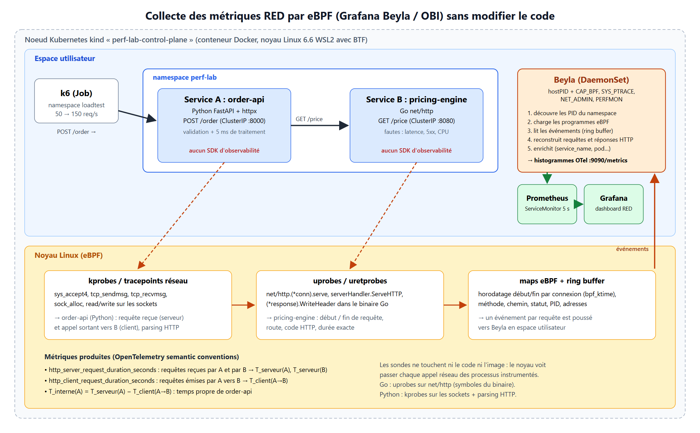

# TP3 : indicateurs de performance d'une chaîne de microservices avec eBPF

Chaîne `k6 → order-api (A) → pricing-engine (B)` déployée sur un cluster **kind**, instrumentée
**sans aucun SDK** par **Grafana Beyla / OBI** (eBPF), métriques collectées par **Prometheus**
et analysées dans **Grafana** (indicateurs RED, décomposition de latence, tail latency,
saturation CPU).



## Contenu du dépôt

| Dossier | Contenu |
|---|---|
| `services/order-api` | Service A, Python FastAPI + httpx (`POST /order`). Aucune librairie d'observabilité. |
| `services/pricing-engine` | Service B, Go `net/http` (`GET /price`). Injection de fautes par variables d'environnement : `BASE_LATENCY_MS`, `SLOW_RATIO`, `SLOW_LATENCY_MS`, `ERROR_RATE`, `CPU_WORK`. |
| `kind/cluster.yaml` | Cluster kind mono-noeud, NodePort Grafana (30300) et Prometheus (30090) publiés sur l'hôte. |
| `k8s/` | Namespace `perf-lab`, Deployments et Services ClusterIP des deux microservices (Kustomize). |
| `k8s/scenarios/` | Patchs des régimes testés : nominal, 10 % d'erreurs, tail latency, saturation CPU (100m). |
| `beyla/beyla.yaml` | Beyla en DaemonSet (hostPID, capacités BPF / SYS_PTRACE / NET_ADMIN / PERFMON), RBAC, ConfigMap, Service et ServiceMonitor. |
| `monitoring/` | Valeurs Helm minimales de `kube-prometheus-stack`. |
| `dashboards/` | Export JSON du tableau de bord Grafana RED, son générateur et le ConfigMap de provisioning. |
| `k6/` | Script de charge (`constant` 50 RPS / 3 min, `ramp` 25 → 150 RPS) et Job Kubernetes. |
| `scripts/` | `run-k6.sh` (lance un tir dans le cluster), `red_stats.py` (tableau RED d'un tir depuis Prometheus). |
| `docs/screenshots/` | Captures de chaque étape. |

## Reproduire

```bash
kind create cluster --config kind/cluster.yaml
helm upgrade --install kps prometheus-community/kube-prometheus-stack --version 93.3.0 \
  -n monitoring --create-namespace -f monitoring/kube-prometheus-stack-values.yaml --wait
docker build -t order-api:1.0 services/order-api
docker build -t pricing-engine:1.0 services/pricing-engine
kind load docker-image order-api:1.0 pricing-engine:1.0 --name perf-lab
kubectl apply -k k8s
kubectl apply -f beyla/beyla.yaml
kubectl apply -f dashboards/grafana-dashboard-configmap.json

# régimes
kubectl -n perf-lab patch deploy pricing-engine --patch-file k8s/scenarios/nominal.yaml
scripts/run-k6.sh nominal constant 50 3m
kubectl -n perf-lab patch deploy pricing-engine --patch-file k8s/scenarios/errors.yaml
scripts/run-k6.sh errors constant 50 3m
kubectl -n perf-lab patch deploy pricing-engine --patch-file k8s/scenarios/nominal.yaml
kubectl -n perf-lab patch deploy pricing-engine --patch-file k8s/scenarios/tail-latency.yaml
scripts/run-k6.sh tail constant 50 3m
kubectl -n perf-lab patch deploy pricing-engine --patch-file k8s/scenarios/cpu-saturation.yaml
scripts/run-k6.sh saturation ramp

python scripts/red_stats.py <début_epoch> <fin_epoch>
```

Grafana : http://localhost:30300 (dashboard « TP3 - RED eBPF »), Prometheus : http://localhost:30090.
